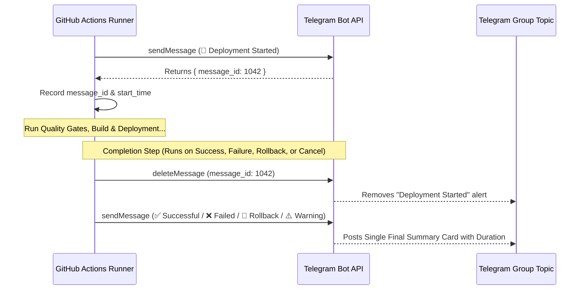

# Telegram Notification Skill (`telegram-notification`)

[](https://agentskills.io/specification)
[](https://opensource.org/licenses/Apache-2.0)
[](https://github.com/features/actions)
[](CHANGELOG.md)

An enterprise-grade, dedicated CI/CD Telegram notification skill built in accordance with the official **[Agent Skills specification](https://agentskills.io/specification)**.

Designed for AI coding assistants (**Antigravity**, **Cursor**, **Claude Code**, **Windsurf**, and **GitHub Copilot**), this skill enables agents and engineers to integrate zero-clutter deployment status cards, rollback alerts, and release broadcasts into any CI/CD workflow using an atomic **Start-Delete-Replace** lifecycle or standalone notifications.

---

## 1. Skill Architecture & Directory Structure

Built on the principle of **progressive disclosure**, the repository separates high-level agent instructions from reference manuals, automation scripts, and workflow templates:

```
telegram-notification-skill/
├── SKILL.md                          # Master agent orchestration & progressive disclosure guide
├── README.md                         # Architecture, installation & operations manual
├── CHANGELOG.md                      # Semantic version history (Keep a Changelog)
├── skill.json                        # Skill discovery manifest & compatibility metadata
├── action.yml                        # Official GitHub Composite Action definition
├── install.sh                        # POSIX installer wrapper
├── update.sh                         # POSIX updater wrapper with rollback protection
├── check-updates.sh                  # POSIX update checker across managed projects
├── status.sh                         # POSIX status inspection wrapper
├── uninstall.sh                      # POSIX uninstaller wrapper
├── bin/                              # Cross-platform CLI utilities
│   ├── skill-manager.py              # Zero-dependency Python 3 engine
│   ├── skill-manager                 # Unix executable wrapper
│   └── skill-manager.ps1             # Windows PowerShell wrapper
├── references/                       # Deep technical reference guides
│   ├── telegram-setup-guide.md       # BotFather, getUpdates, topic IDs & bot permissions
│   ├── card-templates-and-styling.md # HTML entity escaping, Telegram card styling & blockquotes
│   ├── github-actions-integration.md # Workflows, composite action syntax & job lifecycle
│   ├── security-and-secrets.md       # GitHub Secrets, Environments & token protection
│   └── troubleshooting-guide.md      # Root cause analysis & fixes for Telegram API errors
├── scripts/                          # Hardened POSIX helper scripts
│   └── telegram-notify.sh            # Telegram Bot API notification engine with HTML formatting
├── assets/                           # Production-tested GitHub Actions workflow & snippet templates
│   ├── workflows/
│   │   ├── telegram-notification-composite.yml # Workflow using Composite Action
│   │   ├── telegram-notification-script.yml    # Workflow using scripts/telegram-notify.sh
│   │   └── telegram-notification-test.yml      # Standalone verification test workflow
│   └── snippets/
│       └── inline-fallback.sh                  # Zero-dependency curl fallback snippet
└── tests/                            # Automated test suite
    ├── test_distribution.py          # Distribution, symlinking & rollback verification
    └── test_telegram_notify.py       # Notification payloads & HTML escaping verification
```

---

## 2. Notification Lifecycle & Supported Statuses

Traditional CI/CD notifications flood group chats with multiple messages per build. This skill implements an atomic **Start-Delete-Replace** pattern:



### Supported Statuses

| Status | Icon | Card Header | Purpose |
| :--- | :---: | :--- | :--- |
| `start` *(action)* | 🚀 | `🚀 Deployment Started` | Captures start timestamp and `message_id`. |
| `success` | ✅ | `✅ Deployment Successful` | Standard successful completion with duration and site link. |
| `failure` | ❌ | `❌ Deployment Failed` | Standard failed pipeline with failure log link and expandable error logs. |
| `cancelled` | ⚠️ | `⚠️ Deployment Cancelled` | Pipeline cancelled manually or superseded by concurrency lock. |
| `rollback_success` | 🔄 | `🔄 Deployment Rollback Successful` | Automated rollback restored previous stable release. |
| `rollback_failed` | 🚨 | `🚨 Deployment Rollback Failed` | Critical failure where automated rollback failed. |
| `waiting_approval` | ⏳ | `⏳ Deployment Awaiting Approval` | Paused at protected environment gate awaiting reviewer approval. |
| `warning` | ⚠️ | `⚠️ Deployment Completed with Warnings` | Deployed successfully but non-fatal health check flagged warnings. |
| `release` | 🏷️ | `🏷️ Release Published` | Tagged semantic release announcement with changelog notes. |

---

## 3. Environment Variables & GitHub Secrets

Configure the following secrets in your repository (**Settings $\rightarrow$ Secrets and variables $\rightarrow$ Actions**):

| Secret / Variable | Required | Type | Description | Example |
| :--- | :---: | :---: | :--- | :--- |
| `TELEGRAM_BOT_TOKEN` | **Yes** | Secret | Telegram Bot API token issued by `@BotFather` | `7123456789:AAFnk9...` |
| `TELEGRAM_CHAT_ID` | **Yes** | Secret | Telegram chat or supergroup ID | `-1001987654321` |
| `TELEGRAM_MESSAGE_THREAD_ID` | Optional | Var/Secret | Topic/thread ID for forum supergroups | `42` |
| `DEPLOY_URL` / `APP_URL` | Optional | Variable | Public URL to append to successful cards | `https://example.com` |
| `NOTIFICATION_TITLE` | Optional | Variable | Custom card title prefix | `Backend Service` |
| `details` / `NOTIFICATION_DETAILS`| Optional | Input | Error logs or release notes in `<blockquote expandable>` | `Error: Timeout` |
| `silent` / `NOTIFICATION_SILENT` | Optional | Input | Disables push sound/vibration (`true`/`false`) | `false` |

---

## 4. Usage in GitHub Actions

### Option A: Using GitHub Composite Action (Recommended)

```yaml
name: Deploy Application

on:
  push:
    branches: [main]

jobs:
  deploy:
    runs-on: ubuntu-latest
    steps:
      # 1. Notify Start
      - name: "🔔 Telegram: Notify Started"
        id: tg_start
        if: env.TELEGRAM_BOT_TOKEN != '' && env.TELEGRAM_CHAT_ID != ''
        uses: BirtuCan-Software/telegram-notification-skill@v1
        with:
          bot_token: ${{ secrets.TELEGRAM_BOT_TOKEN }}
          chat_id: ${{ secrets.TELEGRAM_CHAT_ID }}
          message_thread_id: ${{ secrets.TELEGRAM_MESSAGE_THREAD_ID }}
          action: start

      - name: 📥 Checkout & Build
        uses: actions/checkout@v4
      - run: npm ci && npm run build

      # 2. Notify Finish (Runs on success, failure, or cancellation)
      - name: "🔔 Telegram: Notify Finished"
        if: always() && env.TELEGRAM_BOT_TOKEN != '' && env.TELEGRAM_CHAT_ID != ''
        uses: BirtuCan-Software/telegram-notification-skill@v1
        with:
          bot_token: ${{ secrets.TELEGRAM_BOT_TOKEN }}
          chat_id: ${{ secrets.TELEGRAM_CHAT_ID }}
          message_thread_id: ${{ secrets.TELEGRAM_MESSAGE_THREAD_ID }}
          action: finish
          status: ${{ job.status }}
          start_message_id: ${{ steps.tg_start.outputs.message_id }}
          start_time: ${{ steps.tg_start.outputs.start_time }}
          deploy_url: ${{ vars.DEPLOY_URL }}
```

### Option B: Standalone Release Broadcast (`action: notify`)

```yaml
- name: "🏷️ Announce Release in Telegram"
  uses: BirtuCan-Software/telegram-notification-skill@v1
  with:
    bot_token: ${{ secrets.TELEGRAM_BOT_TOKEN }}
    chat_id: ${{ secrets.TELEGRAM_CHAT_ID }}
    action: notify
    status: release
    details: ${{ github.event.head_commit.message }}
```

---

## 5. Installation & Distribution Management

This repository includes the cross-platform `skill-manager` distribution utility.

### Global Installation (User-wide)
```bash
./install.sh --global
# Or live symbolic linking:
./install.sh --global --link
```

### Project-Level Installation
```bash
./install.sh --project /path/to/my-project
# Auto-detects agent folder (.gemini/skills, .cursor/skills, .claude/skills, etc.)
```

### Check Updates Across Projects
```bash
./check-updates.sh --status
```

### Atomic Update with Automatic Rollback
```bash
./update.sh --project /path/to/my-project
```

---

## 6. Testing & Quality Verification

Run the automated test suite locally:

```bash
# Distribution & installation tests
python tests/test_distribution.py

# Notification script & HTML escaping tests
python tests/test_telegram_notify.py
```

---

## 7. License

Distributed under the **Apache-2.0** License. See [LICENSE](LICENSE) for details.
