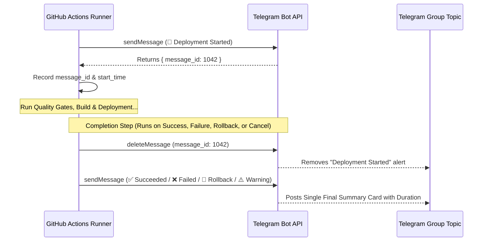

# Telegram Notification Skill

An enterprise-grade, dedicated CI/CD Telegram notification skill for AI coding agents. This skill enables agents to integrate clean, zero-clutter deployment status cards, rollback alerts, and release broadcasts into any GitHub Actions pipeline or deployment script using an atomic **Start-Delete-Replace** lifecycle or standalone notifications.

---

## Progressive Disclosure & Execution Model

This skill is structured according to the **Agent Skills specification** three-tier progressive disclosure model:

1. **Discovery (Startup):** The agent inspects `skill.json` and frontmatter metadata (`name` and `description`) to match user requests for Telegram notifications or CI/CD alerting.
2. **Activation (This Document):** When triggered, the agent reads this `SKILL.md` to guide secrets verification, architecture choice (Composite Action vs. Standalone Script), and workflow integration.
3. **Execution (Deep Linking):** The agent loads specialized reference guides from `references/`, executes or copies scripts from `scripts/`, or instantiates workflow templates from `assets/` as required.

```
telegram-notification-skill/
├── SKILL.md                          # Master agent orchestration & integration guide (this file)
├── README.md                         # Architecture, configuration & operations manual
├── CHANGELOG.md                      # Semantic version history (Keep a Changelog)
├── skill.json                        # Skill discovery manifest & compatibility metadata
├── action.yml                        # Official GitHub Composite Action definition
├── install.sh                        # POSIX installer wrapper
├── update.sh                         # POSIX updater wrapper with rollback protection
├── check-updates.sh                  # POSIX update checker across managed projects
├── status.sh                         # POSIX status inspection wrapper
├── uninstall.sh                      # POSIX uninstaller wrapper
├── bin/                              # Cross-platform CLI utilities
│   ├── skill-manager.py              # Zero-dependency Python 3 engine
│   ├── skill-manager                 # Unix executable wrapper
│   └── skill-manager.ps1             # Windows PowerShell wrapper
├── references/                       # Deep technical references & manuals
│   ├── telegram-setup-guide.md       # BotFather, getUpdates, topic IDs & bot permissions
│   ├── card-templates-and-styling.md # HTML entity escaping, Telegram card styling & blockquotes
│   ├── github-actions-integration.md # Workflows, composite action syntax & job lifecycle
│   ├── security-and-secrets.md       # GitHub Secrets, Environments & token protection
│   └── troubleshooting-guide.md      # Root cause analysis & fixes for Telegram API errors
├── scripts/                          # Hardened POSIX helper scripts
│   └── telegram-notify.sh            # Telegram Bot API notification engine with HTML formatting
└── assets/                           # Production-tested GitHub Actions workflow & snippet templates
    ├── workflows/
    │   ├── telegram-notification-composite.yml # Workflow using Composite Action
    │   ├── telegram-notification-script.yml    # Workflow using scripts/telegram-notify.sh
    │   └── telegram-notification-test.yml      # Standalone verification test workflow
    └── snippets/
        └── inline-fallback.sh                  # Zero-dependency curl fallback snippet
```

---

## 1. Notification Lifecycle & Supported Statuses

### The Start-Delete-Replace Lifecycle
To eliminate noisy in-progress alerts that clutter team communication channels, this skill implements an atomic **Start-Delete-Replace** lifecycle:



### Comprehensive Status Matrix

| Status | Icon | Card Header | Purpose |
| :--- | :---: | :--- | :--- |
| `start` *(action)* | 🚀 | `🚀 Deployment Started` | Initial notification capturing start timestamp and `message_id`. |
| `success` | ✅ | `✅ Deployment Successful` | Standard successful pipeline completion with duration and site link. |
| `failure` | ❌ | `❌ Deployment Failed` | Standard failed pipeline with failure log link and optional error details. |
| `cancelled` | ⚠️ | `⚠️ Deployment Cancelled` | Pipeline cancelled manually or superseded by concurrency lock. |
| `rollback_success` | 🔄 | `🔄 Deployment Rollback Successful` | Automated or manual rollback restored previous stable release. |
| `rollback_failed` | 🚨 | `🚨 Deployment Rollback Failed` | Critical failure where rollback also failed. |
| `waiting_approval` | ⏳ | `⏳ Deployment Awaiting Approval` | Paused at protected environment gate awaiting human review. |
| `warning` | ⚠️ | `⚠️ Deployment Completed with Warnings` | Deployed successfully but non-fatal health check flagged warnings. |
| `release` | 🏷️ | `🏷️ Release Published` | Tagged semantic release announcement with changelog notes. |

---

## 2. Environment Variables & GitHub Secrets

| Variable | Scope | Required | Description | Example |
| :--- | :--- | :---: | :--- | :--- |
| `TELEGRAM_BOT_TOKEN` | Secret | **Yes** | Telegram Bot API token issued by `@BotFather` | `7123456789:AAFnk9...` |
| `TELEGRAM_CHAT_ID` | Secret | **Yes** | Target group, channel, or direct user ID | `-1001987654321` |
| `TELEGRAM_MESSAGE_THREAD_ID` | Secret / Var | Optional | Topic / thread ID for supergroup forum topics | `42` |
| `DEPLOY_URL` / `APP_URL` | Variable | Optional | Public application URL appended to success cards | `https://example.com` |
| `NOTIFICATION_TITLE` | Variable | Optional | Title prefix or project label override | `API Service` |
| `NOTIFICATION_DETAILS` / `details` | Input / Var | Optional | Error summary or release notes in `<blockquote expandable>` | `Error: Connection reset` |
| `NOTIFICATION_SILENT` / `silent` | Input / Var | Optional | Disables push sound/vibration (`true`/`false`) | `false` |

---

## 3. Integration Patterns

### Pattern A: GitHub Composite Action (Recommended)

```yaml
# Step 1: Start
- name: "🔔 Telegram: Notify Deployment Started"
  id: tg_start
  if: env.TELEGRAM_BOT_TOKEN != '' && env.TELEGRAM_CHAT_ID != ''
  uses: BirtuCan-Software/telegram-notification-skill@v1
  with:
    bot_token: ${{ secrets.TELEGRAM_BOT_TOKEN }}
    chat_id: ${{ secrets.TELEGRAM_CHAT_ID }}
    message_thread_id: ${{ secrets.TELEGRAM_MESSAGE_THREAD_ID }}
    action: start

# ... Build & Deploy steps ...

# Step 2: Finish
- name: "🔔 Telegram: Notify Deployment Finished"
  if: always() && env.TELEGRAM_BOT_TOKEN != '' && env.TELEGRAM_CHAT_ID != ''
  uses: BirtuCan-Software/telegram-notification-skill@v1
  with:
    bot_token: ${{ secrets.TELEGRAM_BOT_TOKEN }}
    chat_id: ${{ secrets.TELEGRAM_CHAT_ID }}
    message_thread_id: ${{ secrets.TELEGRAM_MESSAGE_THREAD_ID }}
    action: finish
    status: ${{ job.status }}
    start_message_id: ${{ steps.tg_start.outputs.message_id }}
    start_time: ${{ steps.tg_start.outputs.start_time }}
    deploy_url: ${{ vars.DEPLOY_URL }}
```

### Pattern B: Standalone Release / Broadcast Alert (`action: notify`)
```yaml
- name: "🏷️ Announce Release in Telegram"
  uses: BirtuCan-Software/telegram-notification-skill@v1
  with:
    bot_token: ${{ secrets.TELEGRAM_BOT_TOKEN }}
    chat_id: ${{ secrets.TELEGRAM_CHAT_ID }}
    action: notify
    status: release
    details: ${{ github.event.head_commit.message }}
```

---

## 4. Mandatory Post-Implementation User Delivery Manual

After generating or updating workflow files to include Telegram notifications, the AI agent **MUST** output a complete, beginner-friendly operational manual in markdown. Never terminate without providing this tailored guide to the user.

The manual must include:

### 1. Required GitHub Secrets Table
**Navigation:** Repository $\rightarrow$ **Settings** $\rightarrow$ **Secrets and variables** $\rightarrow$ **Actions** $\rightarrow$ **New repository secret**

| Secret Name | Required | Description | Example |
| :--- | :---: | :--- | :--- |
| `TELEGRAM_BOT_TOKEN` | **Yes** | Bot HTTP API token issued by `@BotFather` | `7123456789:AAFnk9...` |
| `TELEGRAM_CHAT_ID` | **Yes** | Target group, channel, or personal chat ID | `-1001987654321` |
| `TELEGRAM_MESSAGE_THREAD_ID` | Optional | Topic/thread ID for forum supergroups | `42` |

### 2. Optional Environment Variables Table
**Navigation:** Repository $\rightarrow$ **Settings** $\rightarrow$ **Secrets and variables** $\rightarrow$ **Actions** $\rightarrow$ **Variables tab**

| Variable Name | Description | Example |
| :--- | :--- | :--- |
| `DEPLOY_URL` | Public application URL appended to successful deployment cards | `https://example.com` |
| `NOTIFICATION_TITLE` | Custom project or service name prefix (defaults to `Deployment`) | `Mobile API` |

### 3. Step-by-Step Telegram Setup Instructions
1. **Create Bot:** Message `@BotFather` on Telegram $\rightarrow$ `/newbot` $\rightarrow$ copy the returned `TELEGRAM_BOT_TOKEN`.
2. **Add Bot & Permissions:** Add the bot to your group/channel $\rightarrow$ Promote to **Administrator** with **Post Messages** and **Delete Messages** enabled (Delete Messages is required for the zero-clutter Start-Delete-Replace lifecycle).
3. **Find Chat ID:** Send `ping` in the group $\rightarrow$ Open `https://api.telegram.org/bot<TOKEN>/getUpdates` $\rightarrow$ copy `chat.id` (starts with `-100`).
4. **Find Thread ID (If using Topics):** Right-click the topic in Telegram Desktop $\rightarrow$ **Copy Link to Topic** $\rightarrow$ the number at the end of `t.me/c/.../42` is `TELEGRAM_MESSAGE_THREAD_ID`.

### 4. Verification & Testing Procedure
Provide a safe command or workflow dispatch trigger the user can run immediately to verify that notifications are working.
